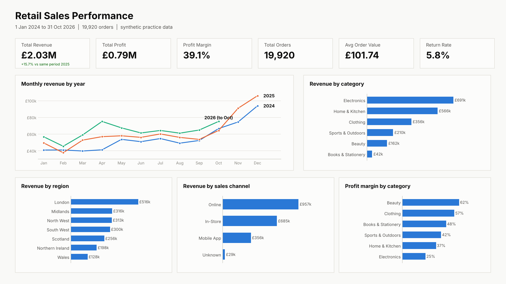

# Retail Sales Dashboard (Power BI)

An end-to-end Power BI project: take a messy 20,000-row retail sales file, clean it in Power Query, model it with DAX, and turn it into a one-page sales performance dashboard.



> The image above is a **layout mock-up** of the target report, drawn from the cleaned data. It is not a Power BI screenshot. See [Project status](#project-status).

## Business questions

- How much revenue and profit are we making, and how is it growing year on year?
- Which product categories, regions and sales channels drive the business?
- Where is margin strong or weak, and how seasonal is demand?
- How large is the returns problem?

## Tools and skills

Power BI Desktop, Power Query (M), DAX, data cleaning, data modelling (date table, relationships), time intelligence, dashboard design, Python (synthetic data generation).

## Repository structure

```
data/         raw dataset, plus a cleaned reference copy to check your work against
powerquery/   M script that cleans the raw data into the Sales table
dax/          Date table and all measures
docs/         step-by-step build guide and the dashboard mock-up
scripts/      Python script that generates the raw dataset (seeded)
report/       the finished .pbix and screenshot go here
```

## The data

Synthetic retail data, generated by [`scripts/generate_data.py`](scripts/generate_data.py): 20,550 raw rows covering 1 Jan 2024 to 31 Oct 2026, with orders, customers, products, regions, sales channels, discounts and returns. It is **not real company data**. Messy problems were injected on purpose so the cleaning step is realistic.

## Data cleaning (Power Query)

| Problem in the raw file | Fix |
|---|---|
| 550 exact duplicate rows | Remove duplicates |
| Dates in 3 formats | Parse as UK day-first |
| Prices stored as text with a pound sign | Strip symbols, convert to number |
| 60 missing unit prices | Fill from the same product's known price |
| Mixed case, extra spaces, typos | Trim, proper-case, replace typos |
| Missing segment, city, channel, payment | Replace with "Unknown" |
| Discount as `10` instead of `0.10` | Divide by 100, blanks become 0 |
| Returned flag as `Y`, `yes`, `TRUE` | Standardise to Yes / No |
| 80 invalid quantities (negative, zero, 100+) | Remove rows outside 1 to 20 |

Result: 19,920 clean rows, with Revenue, TotalCost and Profit columns added. Script: [`powerquery/01_PowerQuery_Sales.m`](powerquery/01_PowerQuery_Sales.m).

## DAX measures

Total Revenue, Total Cost, Total Profit, Profit Margin %, Total Orders, Units Sold, Average Order Value, Unique Customers, Return Rate %, Returned Revenue, Revenue YTD, Revenue PY (like-for-like), Revenue YoY %, Revenue MoM %, Revenue % of Total, Category Rank, and a dynamic subtitle. All in [`dax/02_DAX_Measures.dax`](dax/02_DAX_Measures.dax).

The prior-year measure stops at the same cut-off date as the data, so 2026 (January to October) is compared with January to October 2025 rather than a full year.

## Key insights

Figures calculated from the cleaned data:

- Revenue of about **£2.03M** and profit of about **£0.79M** (39.1% margin) across 19,920 orders.
- **Electronics is 34% of revenue but has the thinnest margin (25%).** Beauty (62%) and Clothing (57%) are far more profitable but smaller.
- **Revenue is seasonal:** November and December made up 27% of 2025 revenue.
- **Growth is healthy:** January to October 2026 is up 15.7% on the same period of 2025.
- **London is the largest region** (about 25% of revenue) and **online is the biggest channel** (about 47%).
- About **5.8%** of orders are returned.

Suggested action: protect Electronics volume, push higher-margin Beauty and Clothing through the online channel, and plan stock and promotions around the November to December peak.

## How to reproduce

1. Install Power BI Desktop (free, Windows only).
2. Follow [`docs/BUILD_GUIDE.md`](docs/BUILD_GUIDE.md): import `data/retail_sales_raw.csv`, paste the Power Query script, add the date table and measures, then build the report page.
3. Check your totals against the expected values in the guide (for example Total Revenue £2,026,713.01).

## Project status

- [x] Dataset generated (reproducible)
- [x] Power Query cleaning script
- [x] DAX date table and measures
- [x] Build guide and target layout
- [ ] Power BI report built and screenshot added to `report/`

The Power Query and DAX code was written and checked by reproducing the same logic in Python; it has not yet been run inside Power BI Desktop.
